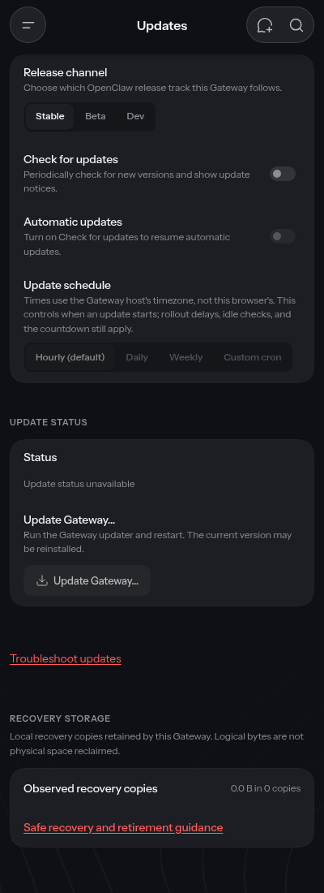
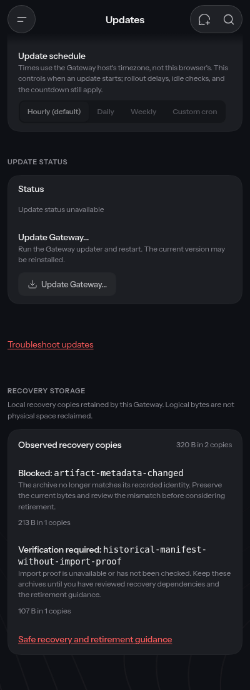
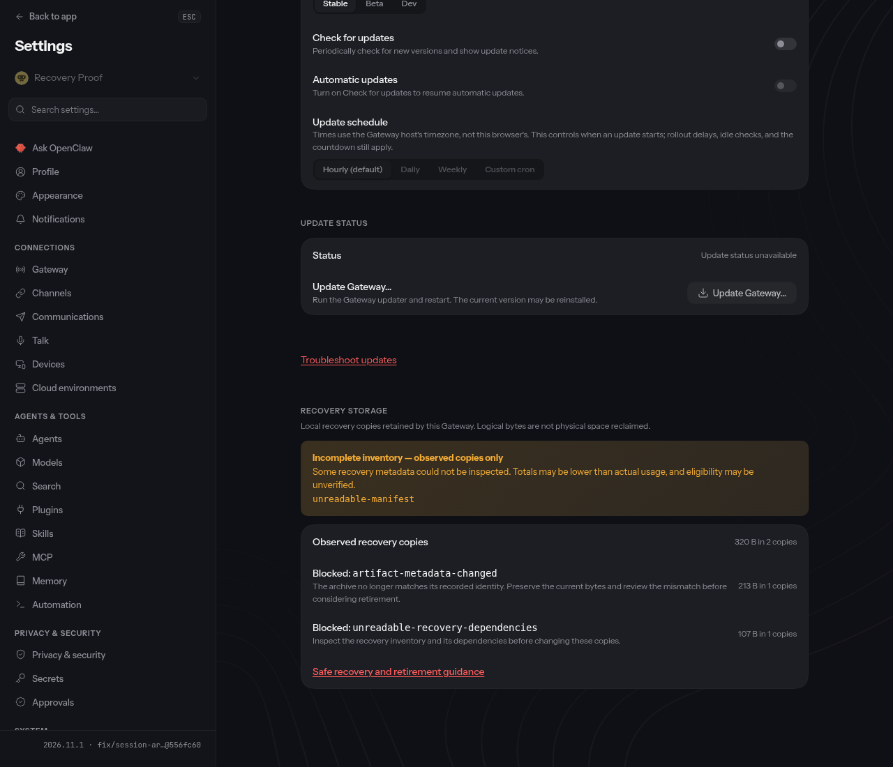

# PR #188378 — current-main integration runtime proof

Candidate: `556fc60f228c8a2437effe2c89926dc0ba1d0483`; integrated main: `3df96dfc805b01d5d16e12040ab519ab67c8d61f`.

## Results

- **Normal built CLI:** ordinary cleanup refuses unverified and identity-changed archives; explicit preview changes no state; retirement removes two selected archives; replay removes zero. Active SQLite bytes, one session and three transcript events stay identical; ten independent-backup files stay identical. [Receipt](normal-cli/summary.json)
- **Latest stable storage upgrade:** official v2026.11.1 creates v3 receipts and schema 27; candidate Doctor upgrades to schema 41 preserving the session and all three events. Controlled interruption leaves pending v5 receipts; candidate resume removes three selected archives and replay removes zero. Retirement preserves active database bytes and eleven backup files. Older stable cleanup/restore refuses pending and disposed v5 state without altering protected bytes, and its exact shipped manifest reader separately refuses v5. [Receipt](stable-upgrade/summary.json)
- **Actual built Gateway and UI:** nine empty/retained/incomplete scenarios at 400/820/1280px through real `update.status` RPC; 123 served assets match disk hashes; no mutation requests, page errors, recovery-section shifts, shell geometry movement, horizontal overflow, or protected archive-byte changes. All nine screenshots were inspected. [Execution](gateway-ui/command.json) · [Detailed observations](gateway-ui/results.json)
- **Integrity:** all 26,549 launcher/dist artifact hashes identical before and after proof; source checkout clean. Canonical `pnpm build:runtime` exits0. [Before](build-before.json) · [After](build-final.json)
- **Focused checks:** 144 distinct storage/cleanup tests and 16 UI tests pass, as do core/UI types, scoped lint, line caps and the test-line ratchet. Final source and harness audit has no actionable finding. [Audit](final-checkpoint-audit.md) · [Verification summary](verification.json)

## Actual boundaries and retained limitations

This is synthetic isolated storage/Doctor/cleanup upgrade and built Gateway/UI proof, **not** an original-reporter installation, npm package-updater/service restart, model/channel conversation, or physical OS-kill proof. Fault injection uses the exact candidate's source retirement owner and progress callback; all normal operations use the built CLI. Stable package and exact internal dependencies were integrity-verified, while other dependencies link read-only to the candidate install.

Console warnings/errors, including blocked service-worker activity and 401/404 responses, remain in the observations; no clean-console claim is made.

A small **Update status** text layout shift remains at tablet/desktop widths; the changed **Recovery storage** section did not shift. The production build exits0 but emits advisory gzip-size baseline excesses (largest chunk +41B; chat/new boot bundles also slightly over). Hosted final-head CI is still required.

Failed attempts are retained in `logs/`: the missing-await regression was corrected without relaxing assertions. Initial CLI setup attempts failed the current safe-temp ancestor check. Moving TMPDIR alone did not change the snapshot cache owner; successful fresh attempts set a private `/tmp` XDG cache. No product guard, file permissions, or candidate source was weakened.

The explicit opt-in retirement and older-reader policy still requires recovery/update-owner acceptance; these tests do not manufacture that decision. No live installation, public PR, merge or deployment was changed by this proof run.

## Visual evidence

Historical mocked-Gateway capture, **before the feature existed**:

Current empty-state view, before loading the synthetic retained data (not a before-feature capture):

Retained data and guidance:

Incomplete metadata remains visibly incomplete:

All other viewport/state captures and same-frame section crops are under `gateway-ui/`.

Historical accepted evidence and earlier failed attempts remain at [the prior immutable proof](https://github.com/jason-allen-oneal/openclaw/blob/bc34ff469ef24177f29da1efeea567d6064636ff/README.md); it is not relabeled as this run. Public harness copies replace local paths with placeholders; private originals and raw outputs remain intact.
