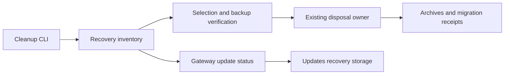

Codex review: needs real behavior proof before merge.

## What this changes

Adds explicitly consented retirement of independently backed-up session archives and displays recovery-storage totals and reasons in Updates.

**Example:** Two synthetic archives contain 320 bytes and have verified independent backups.
- **Before:** Ordinary cleanup protects one archive for missing import proof and blocks the other for changed identity.
- **After:** Explicit selection with history-loss consent retires both; replay removes zero files and preserves SQLite history and backup bytes.

## Review scores

| Measure | Result | What it means |
|---|---|---|
| **Overall readiness** | 🦐 gold shrimp **(3/6)** | Substantial CLI proof and meaningful lifecycle regressions support the work, but the runtime read boundary, real-Gateway UI proof, and retention direction remain unsettled. |
| **Proof confidence** | 🦐 gold shrimp **(3/6)** | Real behavior proof is necessary before merge. See [Before merge](#before-merge). |
| **Patch quality** | 🦐 gold shrimp **(3/6)** | 1 actionable review finding remain. |

## Product

**Kind:** Feature · **Worth it:** Needs a maintainer decision · **Fix scope:** Complete
**User problem:** Operators cannot reclaim protected session-import archive space through a supported command even after preserving an independent backup.
**Reason:** The requested capability is useful, but authorizing loss of potentially unique history changes an intentional preservation contract.

## Merge readiness

⛔ **Blocked before merge - 3 items remain**

Keep open: this PR provides meaningful archive-retirement work, but changing the preservation contract needs an owner decision.

**Priority:** P2
**Reviewed head:** `983ac6b5bfc091fe6130d1f6eb87ccd75207f046`
**Owner decision:** Required. See [Decision needed](#decision-needed).

## Decision needed

- **Question:** Should operators be allowed to retire manifested archives without import proof using independent raw backups, complete-group selection, and separate history-loss consent?
- **Recommendation:** **Approve bounded explicit retirement:** Approve this opt-in contract, including manual backup recovery and older binaries refusing the new receipts, subject to the implementation finding and proof gate.
- **Why:** This deliberately changes retention of potentially unique history and introduces version-5 receipts; neither this PR nor its linked issue records maintainer approval.

## Before merge

- [ ] **Add real behavior proof** - Built-CLI logs exercise refusal, preview, retirement, replay, and preserved data on synthetic state, and the inspected screenshots show the new panel. The Gateway-to-browser path remains unproven because UI evidence uses a mocked Gateway; provide real-Gateway console/network or log evidence and scoped layout checks, redacting IPs, credentials, phone numbers, and non-public endpoints. After adding proof, update the PR body, then request a new review with `@clawsweeper re-review`. The PR author or someone with repository write access can request it.
- [ ] **\[P2\] Keep recovery ledger reads off the Gateway main thread (P2)** - An update.status request with includeRecoveryCopies now invokes the synchronous CLI inventory directly. For a SQLite-backed Gateway whose shared database fits the metadata budget and has an update-capture directory, this reaches readCompletedUpdateHistory → listUpdateRuns and performs native SQL on the request thread; a cold native reader can additionally reach prepareSqliteReadOnlyLocationSync → spawnSync. The inventory’s elapsed-time checks do not interrupt those blocking operations, so opening Updates can stall unrelated Gateway work. This also violates the database rule against adding runtime SQL on the Gateway main thread. Obtain the needed ledger facts through the existing asynchronous database owner, or execute the inventory through an owned worker while preserving its bounds.
- [ ] **Resolve maintainer decision** - Resolve the maintainer decision shown above before merge.

## Findings

- [P2] [P2] Keep recovery ledger reads off the Gateway main thread — `src/gateway/server-methods/update-status.ts:153-157`

### Tests

- Missing end-to-end proof: Show Recovery Storage against an isolated real Gateway, including incomplete inventory and the scoped layout-shift checks; the supplied browser setup mocks the Gateway.

<strong>Agent review details</strong>

### How this fits together

The update cleanup CLI selects recovery originals, verifies backups under maintenance custody, and delegates deletion and durable receipts to the existing disposal owner; the Gateway projects inventory totals to Updates.

### Technical review

Best possible solution:

Use the existing retirement owner under an approved preservation policy and serve recovery-storage reads through the Gateway’s asynchronous database owner.

Do we have a high-confidence way to reproduce the issue?

Current-main source intentionally retains archives with missing import proof or changed identity; supplied built-CLI output demonstrates both outcomes on synthetic state, and no reviewer-run tests were performed.

Is this the best way to solve the issue?

Complete-group selection and independent backups fit the existing disposal lifecycle, but healthy SQLite stores alone cannot establish that archive history is dispensable.

Full review comments:

- [P2] [P2] Keep recovery ledger reads off the Gateway main thread — `src/gateway/server-methods/update-status.ts:153-157`
  An update.status request with includeRecoveryCopies now invokes the synchronous CLI inventory directly. For a SQLite-backed Gateway whose shared database fits the metadata budget and has an update-capture directory, this reaches readCompletedUpdateHistory → listUpdateRuns and performs native SQL on the request thread; a cold native reader can additionally reach prepareSqliteReadOnlyLocationSync → spawnSync. The inventory’s elapsed-time checks do not interrupt those blocking operations, so opening Updates can stall unrelated Gateway work. This also violates the database rule against adding runtime SQL on the Gateway main thread. Obtain the needed ledger facts through the existing asynchronous database owner, or execute the inventory through an owned worker while preserving its bounds.
  Confidence: 0.94

Overall correctness: patch is incorrect
Overall confidence: 0.9

AGENTS.md: found and applied where relevant.

Codex review notes: model internal, reasoning medium; reviewed against [c69c15f291c9](https://github.com/openclaw/openclaw/commit/c69c15f291c97c3744108fec6a499f5537fc17c1).

### Provenance checked

- `Conservative archive retirement` changes intended behavior with a stated reason (78d2d914db75e310bb7dfc4ca2d680c137ce9aa4: Retire verified recovery originals while protecting malformed or unique unimported history and preserving recovery mappings.)
- `Durable disposal owner` keeps the original intent (78d2d914db75e310bb7dfc4ca2d680c137ce9aa4: Persist all referencing claims before moving originals and retain resumable disposal receipts.)
- `Ordinary update-status polling` keeps the original intent (04eda802fe75fe0cfca3601b54092aa3140931f7: Avoid repeated private database copies during polling by consuming the existing owner’s status projection.)

### Testing

Proof path: shipped entry point.

### Security

None.

### Evidence

What I checked:

- **Pinned introduced change:** Reviewed the merge-base-to-head changes separately from base movement; current main lacks the explicit retirement options. ([`src/commands/update-cleanup-session-archives.ts:290`](https://github.com/openclaw/openclaw/blob/983ac6b5bfc091fe6130d1f6eb87ccd75207f046/src/commands/update-cleanup-session-archives.ts#L290), [983ac6b5bfc0](https://github.com/openclaw/openclaw/commit/983ac6b5bfc091fe6130d1f6eb87ccd75207f046))
- **Retention direction remains undecided:** The report at https://github.com/openclaw/openclaw/issues/186088 requests supported disposition and UI visibility; its discussion contains no human maintainer approval of deleting unverifiable manifested history, and this PR has no recorded maintainer review.
- **Original preservation contract:** https://github.com/openclaw/openclaw/pull/133864 introduced conservative retirement while explicitly protecting unique unimported history; history across the earlier migration-run filename corroborates that intent. ([`src/commands/doctor-session-sqlite-retirement.ts:62`](https://github.com/openclaw/openclaw/blob/78d2d914db75e310bb7dfc4ca2d680c137ce9aa4/src/commands/doctor-session-sqlite-retirement.ts#L62), [78d2d914db75](https://github.com/openclaw/openclaw/commit/78d2d914db75e310bb7dfc4ca2d680c137ce9aa4))
- **Gateway synchronous read path:** The new handler calls collectRecoveryDiskUsage directly. With a shared SQLite database inside the metadata budget and an update-capture directory, inventory reads synchronous update history; cold native reads can reach prepareSqliteReadOnlyLocationSync and spawnSync. ([`src/gateway/server-methods/update-status.ts:154`](https://github.com/openclaw/openclaw/blob/983ac6b5bfc091fe6130d1f6eb87ccd75207f046/src/gateway/server-methods/update-status.ts#L154), [983ac6b5bfc0](https://github.com/openclaw/openclaw/commit/983ac6b5bfc091fe6130d1f6eb87ccd75207f046))
- **Existing status-read ownership:** https://github.com/openclaw/openclaw/pull/154233 established owner-backed status reads to avoid database-copy latency; the database rules also prohibit adding runtime SQL on the Gateway main thread. Public docs: [`docs/reference/database-schemas/worker-access.md`](https://docs.openclaw.ai/reference/database-schemas/worker-access). ([`docs/reference/database-schemas/worker-access.md:32`](https://docs.openclaw.ai/reference/database-schemas/worker-access), [04eda802fe75](https://github.com/openclaw/openclaw/commit/04eda802fe75fe0cfca3601b54092aa3140931f7))
- **Supplied CLI behavior and receipt evidence:** Inspected commands, raw cleanup output, summaries, and receipts in the revision-pinned evidence at https://gist.github.com/jason-allen-oneal/cce57bad7470dc6c18447b0b7bf7c324/679b75e5852bb765dd04c4446735eb089f6ed4f4. The built launcher refuses ordinary cleanup, previews two candidates, retires 320 bytes, and replays without further deletion. The final commit changes types and a diagnostic expectation, supporting reuse of that runtime proof. ([`src/cli/update-cli/cleanup.ts:80`](https://github.com/openclaw/openclaw/blob/2dee5c7f729b5bf80193e8463c91b785ecc56ea1/src/cli/update-cli/cleanup.ts#L80), [2dee5c7f729b](https://github.com/openclaw/openclaw/commit/2dee5c7f729b5bf80193e8463c91b785ecc56ea1))

Likely related people:

- **Jason (Json):** Raw commit b7940222e3b0827580de712372ac87fd3f87d871 adds src/commands/recovery-disk-usage.ts:35 relative to its recorded parents. This identifies author metadata, not feature responsibility or a PR merger. (role: source-line author; confidence: high; commits: [b7940222e3b0](https://github.com/openclaw/openclaw/commit/b7940222e3b0827580de712372ac87fd3f87d871); files: `src/commands/recovery-disk-usage.ts`)

### PR surface

Source +1042, Tests +1034, Docs +74, Other +4. Total +2154 across 34 files. Added test files: 2.

View PR surface stats

| Area | Files | Added | Removed | Net |
|---|---:|---:|---:|---:|
| Source | 22 | 4398 | 3356 | +1042 |
| Tests | 9 | 1039 | 5 | +1034 |
| Docs | 1 | 74 | 0 | +74 |
| Config | 0 | 0 | 0 | 0 |
| Generated | 0 | 0 | 0 | 0 |
| Other | 2 | 4 | 0 | +4 |
| **Total** | **34** | **5515** | **3361** | **+2154** |

### Review metrics

| Metric | Value | Why it matters |
|---|---|---|
| **New operator controls** | 3 CLI options and 1 opt-in RPC parameter | The CLI controls select archives, locate independent backups, and acknowledge history loss; the RPC parameter requests recovery metadata. |
| **Persisted receipt contract** | Manifest version 5 | Explicit retirement retains prior import evidence and backup provenance in a format older readers reject. |

### Labels

Label changes:

- add `P2`: This improves an advanced maintenance workflow for retained disk usage without evidence of an urgent core-runtime failure.
- add `merge-risk: 🚨 compatibility`: Explicit retirement creates persisted version-5 receipts that older binaries cannot consume; acceptance of that contract remains a maintainer choice.
- add `rating: 🦐 gold shrimp`: Overall readiness is 🦐 gold shrimp; proof is 🦐 gold shrimp and patch quality is 🦐 gold shrimp.
- add `status: 📣 needs proof`: The PR needs real behavior proof before ClawSweeper can clear the contributor ask.

Label justifications:

- `P2`: This improves an advanced maintenance workflow for retained disk usage without evidence of an urgent core-runtime failure.
- `merge-risk: 🚨 compatibility`: Explicit retirement creates persisted version-5 receipts that older binaries cannot consume; acceptance of that contract remains a maintainer choice.
- `rating: 🦐 gold shrimp`: Overall readiness is 🦐 gold shrimp; proof is 🦐 gold shrimp and patch quality is 🦐 gold shrimp.
- `status: 📣 needs proof`: The PR needs real behavior proof before ClawSweeper can clear the contributor ask.

### Rating scale

6/6 🦀 challenger crab · 5/6 🦞 diamond lobster · 4/6 🐚 platinum hermit · 3/6 🦐 gold shrimp · 2/6 🦪 silver shellfish · 1/6 🧂 unranked krab. Overall follows the weaker of proof and patch quality; ✨ marks media proof (a screenshot, video, or linked artifact) that directly shows the changed behavior.

### Workflow

ClawSweeper edits this one comment on every review. Comment `@clawsweeper re-review` for a fresh review only. Repair and merge execution lanes are retired.

_Reviewed October 30, 2026, 10:11 AM ET / 14:11 UTC._

<!-- clawsweeper-verdict:needs-human item=188378 sha=983ac6b5bfc091fe6130d1f6eb87ccd75207f046 confidence=high updated_at=2026-10-30T14:02:23Z reviewed_at=2026-10-30T14:11:56.126Z lease_owner=github-run-41068237333-1 lease_comment_id=6524664867 source_revision=63cf7863c70ceeff4090effcc9bdc4009c27ac2d90a6ac3b3c3764bbdceaffb0 hold=blocked findings=1 -->
<!-- clawsweeper-review-state:blocked item=188378 sha=983ac6b5bfc091fe6130d1f6eb87ccd75207f046 v=1 -->

<!-- clawsweeper-review-version item=188378 reviewed_at=2026-10-30T14:11:56.126Z sha=983ac6b5bfc091fe6130d1f6eb87ccd75207f046 source_revision=63cf7863c70ceeff4090effcc9bdc4009c27ac2d90a6ac3b3c3764bbdceaffb0 lease_owner=github-run-41068237333-1 lease_comment_id=6524664867 v=1 -->

<!-- clawsweeper-review item=188378 -->
